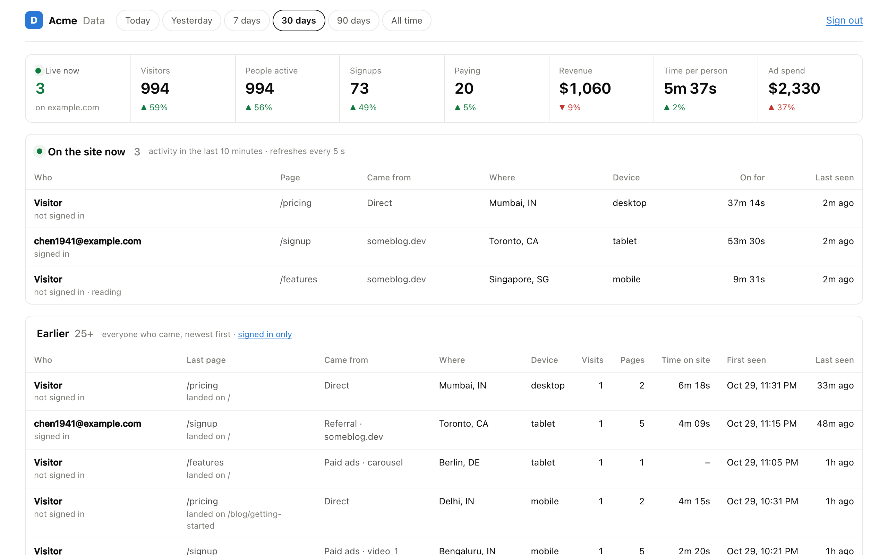
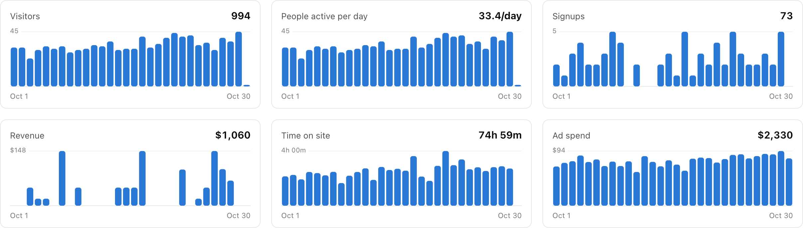
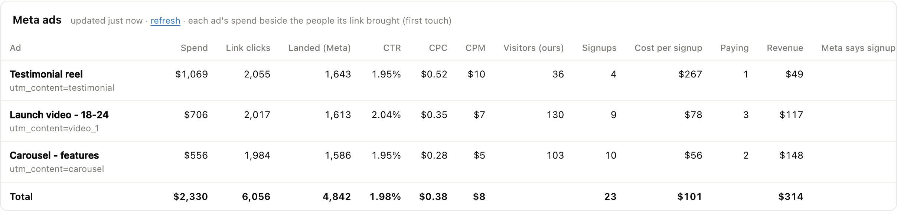

# Data 1-1

**Your own analytics, built for one question: which source brought the people who paid.**

Who is on your site right now. Where every visitor came from. What they did, how long they actually read, who signed up, who paid — and what each ad earned against what it cost. One private dashboard, on your own database, for your own site.



## Set it up with your coding agent

Give your agent (Claude Code, Cursor, Codex, Copilot…) this repository and one sentence:

```
Set up analytics for my website using https://github.com/jatinjain25/data-1-1 - follow its AGENTS.md.
```

[AGENTS.md](AGENTS.md) is a complete runbook written for agents. Your agent will:
1. ask you about a dozen questions: domain, timezone, currency, who may sign in, how you take payments;
2. create the database and deploy the dashboard;
3. add a one-line tag to your site;
4. connect sign-ins, payments and ads;
5. prove it all works with `npm run doctor`.

## Or look at it first

```
git clone https://github.com/jatinjain25/data-1-1 && cd data-1-1
npm install
npm run seed-demo
npm run dev
```

Open http://localhost:5180 and sign in with the password `dev`. That's 60 days of demo data on a real Postgres running in-process. Nothing else to install.

## What you get

| | |
|---|---|
| **Live now** | Everyone with activity in the last 10 minutes: page, where they came from, city, device, how long they've been on. |
| **Everyone who came** | One row per person (by account when signed in, otherwise by browser), with their full timeline: pages, clicks, events, payments. |
| **Real time spent** | Counted only while the page is visible *and* in use, so a tab left open overnight isn't eight hours of reading. |
| **People** | Every account: when they signed up, what brought them, time spent, days active, the product actions you choose, what they paid. |
| **Where people come from** | First touch by channel, source, campaign, ad, referrer, landing page, city, country and device. Each row shows the visitors, signups *and revenue* that source produced. |
| **Revenue** | Stripe, Razorpay and Dodo webhooks, or your own server. Each charge is counted once and credited to the visit that brought the buyer, even if they never signed in. |
| **Meta ads** | Each ad's spend, CTR, CPC and CPM beside the visitors, signups and revenue its link actually brought, compared with what Meta's pixel claims. |
| **Session replays** | "Watch" links from Mixpanel Session Replay, next to the person who did it. |
| **First-visit survey** | Ask new visitors what they want; see ranked answers and everyone who answered. |




## Honest numbers

- **People, not page loads.** A browser counts as a visitor only after 5 seconds on a visible page. That drops load-and-leave scrapers that still run JavaScript.
- **Bots are flagged, never deleted.** Four rules flag them:
  - a crawler user agent;
  - `navigator.webdriver`;
  - an address in Meta's, AWS's or GCP's published ranges (ad-platform crawlers that render your page and stay on it);
  - a burst of new ids from one IP.
- **Signed-in people count once,** across every device.
- **A range the server can't honour is refused**, never quietly swapped for a default.

## Private by design

- **IP addresses are never stored**, only a salted hash used for bot detection.
- **Only the page path is kept:** the query string and the full referrer URL are dropped, and only the referrer's host is stored.
- **Ad click ids are kept by name only** ("fbclid"), never their value.
- **Do Not Track is honoured** before any id is created. There's no fingerprinting and no third-party script.
- **The tag is served from your own domain** through a proxy, so it's first-party.
- **Only you can open the dashboard:** Google sign-in limited to the emails you list, re-checked on every request.

## How it's built

- **One Postgres schema** (`sitedata`, in [`sql/schema.sql`](sql/schema.sql)). Every report is a SQL function you can query yourself. It runs on any Postgres 14+: Neon, Supabase, Railway, RDS or your own.
- **A small Node API** ([`server/`](server)): `collect` (public, write-only), `query` (gated), `auth`, `ingest` (your server), `webhook` (payments), `cron` (daily). It runs on Vercel (`api/`) or any Node host or Docker (`server.js`).
- **A 2 KB tracker** (gzipped) ([`public/t.js`](public/t.js)). It handles single-page apps, sends with `sendBeacon`, and has no dependencies.
- **A React dashboard** ([`src/`](src)) with no chart library.
- **All configuration** is in [`site.config.js`](site.config.js); secrets are in [`.env.example`](.env.example).
- **Tests:** `npm test` runs 51 tests, including the SQL on in-process Postgres. No network, database or keys needed.

## License

MIT
